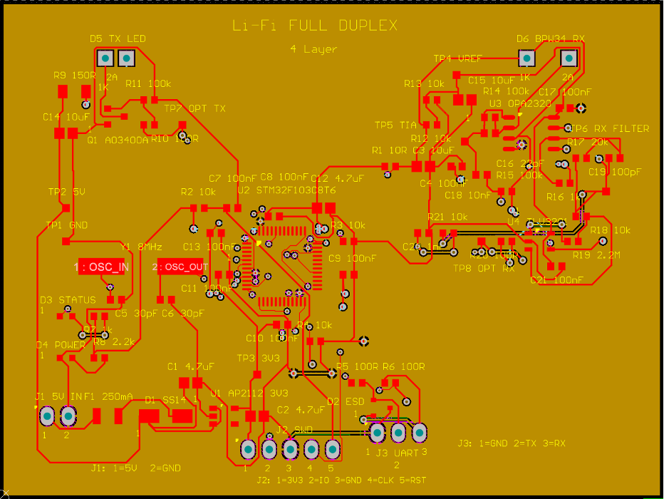
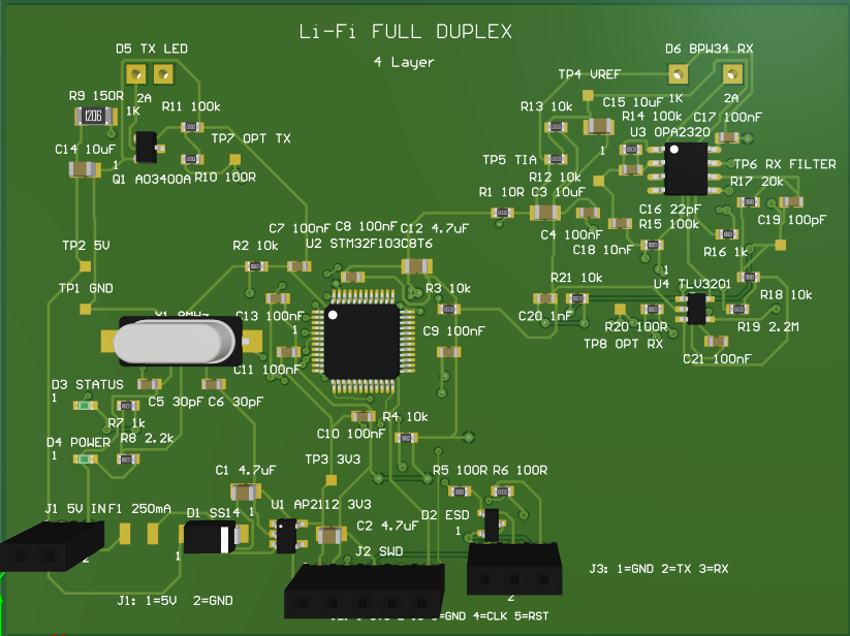
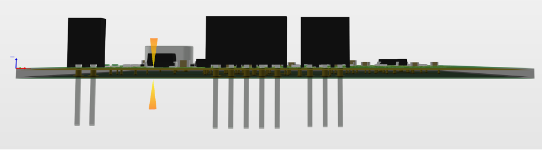

# Li-Fi Transceiver PCB

An Altium Designer hardware project for a four-layer visible-light communication transceiver. It combines an STM32-based controller, a red LED optical transmitter, and a BPW34 photodiode receiver.

## Design overview

- **Optical transmit path:** STM32 control drives an AO3400A MOSFET and Kingbright WP7113SRD red LED.
- **Optical receive path:** A Vishay BPW34 photodiode feeds an OPA2320 analog stage and TLV3201 comparator before the receive signal reaches the controller.
- **Power and access:** A protected 5 V input feeds an AP2112K 3.3 V regulator. The board includes SWD and 3.3 V UART connectors, status LEDs, and test pads.
- **PCB stack:** Four layers with 10 Top-to-L2 ground blind vias, 34 Top-to-L3 supply/reference blind vias, and 50 Top-to-Bottom signal through vias (94 total). The saved stack defines `Thru 1:4`, `Blind 1:2`, and `Blind 1:3` via types. Ground routing is restricted to Top/L2 and supply routing to Top/L3.

## Open the project

1. Open [`LiFi_Via_Types.PrjPcb`](LiFi_Via_Types.PrjPcb) in Altium Designer.
2. Open [`Transceiver_Connected.SchDoc`](Transceiver_Connected.SchDoc) for the schematic and [`LiFi_Connected_no_dr.PcbDoc`](LiFi_Connected_no_dr.PcbDoc) for the PCB layout.
3. The repository includes [`LiFi_Optics.PcbLib`](LiFi_Optics.PcbLib) for the project-created footprints. Other Celestial library files referenced by the project are not included in this repository.

This repository contains hardware design files and review data. It does not contain STM32 firmware or a demonstrated communication performance test.

## PCB views

These views were extracted from the project report. The 2D image shows the Altium layout; the 3D images show the component side and board profile.

## Files

| Path | Purpose |
| --- | --- |
| `LiFi_Via_Types.PrjPcb` | Altium project and document references |
| `Transceiver_Connected.SchDoc` | Editable transceiver schematic |
| `LiFi_Connected_no_dr.PcbDoc` | Editable four-layer PCB |
| [`LiFi_Optics.PcbLib`](LiFi_Optics.PcbLib) | Project-created optical component footprints and test pad |
| `pcb-2d.png`, `pcb-3d.png`, `pcb-side.png` | PCB layout and assembly views shown above |
| [`BOM.csv`](BOM.csv) and [`Component_Pin_Map.csv`](Component_Pin_Map.csv) | Component list and pin-to-net map |
| [`Design Rule Check - LiFi_Connected_no_dr.html`](Design%20Rule%20Check%20-%20LiFi_Connected_no_dr.html) and [`.drc`](Design%20Rule%20Check%20-%20LiFi_Connected_no_dr.drc) | Saved native Altium DRC reports used for review |

Footprint dimensions and source links are documented in [`CUSTOM_FOOTPRINTS.md`](CUSTOM_FOOTPRINTS.md).

## Verification and fabrication status

The saved Altium DRC report ** lists **0 warnings and 0 rule violations**.

Before fabrication, rerun DRC against the chosen manufacturer's rules, check the optical and analog paths on hardware, and confirm that the fabricator supports the Top-to-L2 and especially Top-to-L3 blind-via spans and layer buildup. Review the 30 pF crystal load capacitors and tunable receive-path components on the assembled board.
